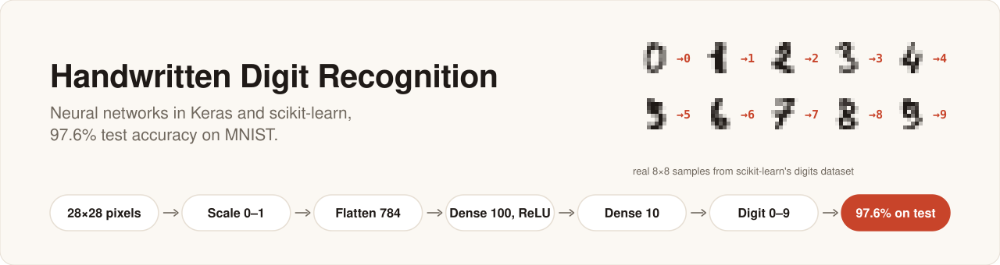

<p align="center">
  <picture>
    <source media="(prefers-color-scheme: dark)" srcset="docs/banner-dark.svg">
    
  </picture>
</p>

<p align="center">
  
  
  
  
  
</p>

Two small neural networks that classify handwritten digits (0–9): one in scikit-learn on 8×8 images, one in Keras on the full 28×28 MNIST dataset. Built in Google Colab in 2023–24 while learning deep learning.

## Results

| Notebook | Dataset | Model | Test accuracy |
|---|---|---|---|
| [MNIST digit prediction (scikit-learn)](Mnist_Handwritten_digit_prediction_using_Neural_Network.ipynb) [](https://colab.research.google.com/github/prantopi/handwritten-digit-recognition/blob/main/Mnist_Handwritten_digit_prediction_using_Neural_Network.ipynb) | scikit-learn `load_digits`: 1,797 images, 8×8 | `MLPClassifier`, default settings | **96.0%** |
| [MNIST with Keras](Untitled_4.ipynb) [](https://colab.research.google.com/github/prantopi/handwritten-digit-recognition/blob/main/Untitled_4.ipynb) | Keras MNIST: 60,000 train / 10,000 test, 28×28 | Flatten → Dense(100, ReLU) → Dense(10) | **97.6%** |

## The Keras model

```python
model = keras.Sequential([
    keras.layers.Flatten(input_shape=(28, 28)),
    keras.layers.Dense(100, activation="relu"),
    keras.layers.Dense(10, activation="sigmoid"),
])
model.compile(optimizer="adam",
              loss="sparse_categorical_crossentropy",
              metrics=["accuracy"])
model.fit(X_train, y_train, epochs=5)
```

Pixel values are scaled to 0–1 before training. Five epochs take under a minute on Colab and reach 97.6% on the 10,000 test images. The notebook ends with a confusion matrix drawn as a seaborn heatmap, which shows which digits get mixed up. The most common mistakes are 3s read as 5s (15 times), 4s read as 9s (13 times), and 8s, which have the lowest accuracy of any digit at 95.7%.

## Run it

Click an "Open in Colab" badge, then **Runtime → Run all**. Both datasets download automatically.

To run locally:

```bash
pip install tensorflow scikit-learn matplotlib seaborn numpy jupyter
jupyter notebook
```

## Next steps I'd try

- `softmax` on the output layer, which suits single-label classification better than `sigmoid`.
- A small CNN (two Conv2D + pooling layers), which usually reaches about 99% on MNIST.
- A validation split during training to watch for overfitting.
